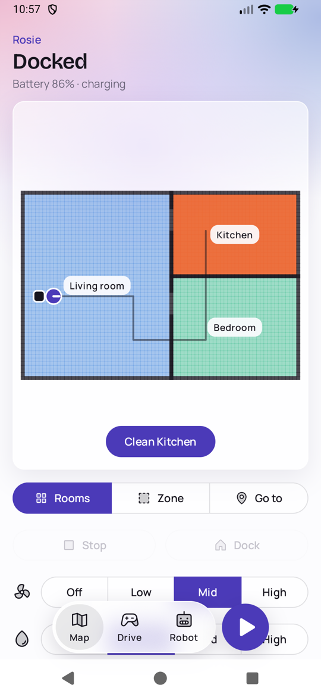
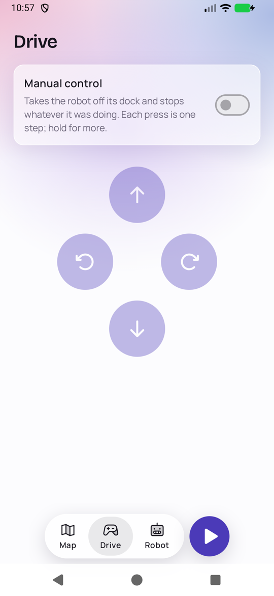
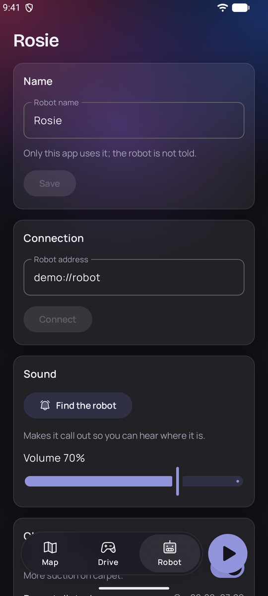
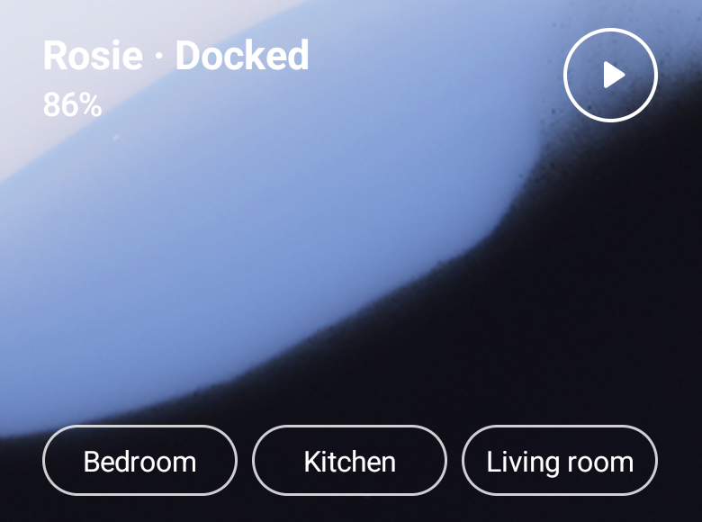
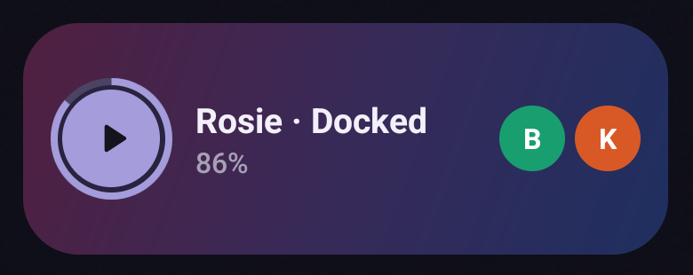
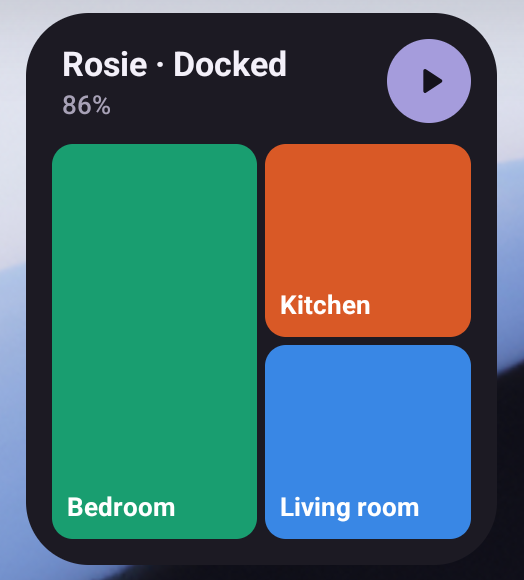

# Congatrol

A small app for robot vacuums running [Congatudo](https://congatudo.cloud) or
[Valetudo](https://valetudo.cloud): the map, and the usual things to do with it, on your phone
instead of in the robot's web interface.

It runs on **Android and iOS** — one Kotlin Multiplatform codebase, the same app on both — and
talks to the robot directly over your home network, using the REST API the robot itself serves.
There is no account, no cloud and no server in between.

<p>
  
  
  
</p>

> **Requires Congatudo.** The app does not talk to a stock robot or to the manufacturer's cloud.
> The robot has to run [Congatudo](https://congatudo.cloud) — which means rooting it and
> installing Congatudo first — and the app then uses the API Congatudo serves. Valetudo serves
> the same API, so robots running it should work too, but that has not been tried.

> [!WARNING]
> **This app is 100% vibe coded** — by me, lying on the couch. Every line was written by an AI
> coding agent from my prompts; no human wrote or reviewed the code by hand. It has unit tests and
> was tried against exactly one robot, my Cecotec Conga running Congatudo. It can send your robot
> driving around your flat, so treat it accordingly.
>
> What keeps it honest is tests, not review: unit tests for the parsing and the invented robot, and
> [Maestro](https://maestro.dev) end-to-end flows (`maestro/`) that tap through the real app on an
> emulator against the invented robot — never against a real one.

## What it does

- **Map** — the robot's map, live, with the robot, its dock and the path of the current run.
  Pinch to zoom, drag to move. Pick rooms to clean, draw a zone to clean, or tap a spot to send
  the robot there. Suction and water presets, stop, and return to dock.
- **Rooms** — the pencil on the map sets the rooms up: split one in two along a line you draw,
  join two, or give one a name. The robot keeps them; the app only asks.
- **Start / pause** — the round button beside the tab bar, from every screen.
- **Drive** — manual control: forward, backward, turn. Hold a button to keep going.
- **Robot** — give the robot a name, set its address, make it call out so you can find it,
  speaker volume, carpet mode, how worn the brushes and filter are (with reset), and what
  model and software it runs.
- **Widgets** (Android) — three home screen widgets that start the robot, show its battery and
  clean a room you named with one tap; see [below](#widgets).

What a robot cannot do is left out: the app asks the robot for its capabilities and only shows
what is there.

## Widgets

Android only, in three looks. Each one shows the robot's name, what it is doing and its battery,
has a button that starts it, and has a button for every room you named: tap one and the robot
cleans that room, and no other. Name rooms on the map, with the pencil; the robot keeps the
names. Tapping anywhere else opens the app. All three follow the system's light and dark mode.

**Clear** — 3 × 2, no background at all: the words and outlined buttons sit straight on the
wallpaper, in white in dark mode and black in light mode. Made one cell high, it is only the
start button and the battery.



**Ring** — 3 × 1, one row in the app's glow: the battery is a ring round the start button, and
each room is a circle with its initial, in its colour on the map. The wider you make it, the more
rooms fit; made one cell wide, it is only the ring.



**Floorplan** — 2 × 2, the rooms as tiles in their colours on the map: the first room large,
the others stacked beside it. Tap a tile to clean that room. Made one cell high, the tiles shrink
to a thumbnail beside the name and the start button.



The widgets ask the robot every half hour, when you leave the app, and after you press one of
their buttons, and never in between, so they do not keep the phone or the robot awake.

## Using it with Congatudo

Congatrol is only the remote control; Congatudo does the real work. Set that up first, following
[the Congatudo guides](https://congatudo.cloud) — this is a summary, not a replacement:

1. **Root the robot.** Congatudo supports the Cecotec Conga 3XXX (except the 3890), 4XXX (except
   the 4690), 5090 and 5490. The [robot setup guide](https://congatudo.cloud/installation/robot-setup/)
   puts the robot on your Wi-Fi and gets you a root shell over SSH.
2. **Install Congatudo**, in one of two ways:
   - [On the robot](https://congatudo.cloud/installation/standalone-installation/) — Congatudo runs
     on the robot itself, and its web interface is at `http://<robot-ip>`.
   - [In Docker](https://congatudo.cloud/installation/docker-installation/) on another machine
     on your network, such as a Raspberry Pi — the robot is pointed at that machine, and the web
     interface is at `http://<server-ip>:8080`.
3. **Check the web interface.** Open that address in a browser: if Congatudo shows the robot and
   its map, the app will too.
4. **Connect the app.** Install Congatrol, open it, and enter the same address you opened the web
   interface with — `192.168.1.50`, `robot.local` or, for Docker, `192.168.1.20:8080`. The phone
   has to be on the same network. The address is kept on the device; nothing is preconfigured,
   and it can be changed later under Robot › Connection.

The app then shows what Congatudo reports the robot can do, and hides the rest.

Congatudo serves plain HTTP only, and so the app speaks plain HTTP to it. Keep the robot on a
network you trust.

No robot at hand? `just install android demo` launches the app on an invented one.

## Building

Kotlin Multiplatform with Compose Multiplatform: one shared UI for Android and iOS, plus a
desktop window for development.

You need JDK 17 or newer, the Android SDK, and — for iOS — Xcode. [just](https://just.systems)
runs the recipes:

```sh
just install android        # build, install and launch on a connected device or emulator
just install android demo   # the same, talking to an invented robot
just install ios            # the same on the iOS simulator
just hot                    # desktop window with hot reload, on the invented robot
just test                   # unit tests
just e2e android            # end-to-end flows on a running emulator, on the invented robot
just lint                   # ktlint and Android lint
just licenses               # regenerate the in-app licence list after changing dependencies
```

`just hot` talks to a real robot when `CONGATROL_ROBOT` is set to its address.

The end-to-end flows are in [`maestro/`](maestro) and need [Maestro](https://maestro.dev). They
drive an emulator, not a phone that happens to be connected, and never reach a real robot.

## Licences

Congatrol is under the [MIT licence](LICENSE).

The fonts, Bricolage Grotesque and Manrope, are under the SIL Open Font License 1.1. The icons
are [Phosphor](https://phosphoricons.com), under the MIT licence. The libraries are under the
Apache License 2.0. The texts are in [`licenses/`](licenses), and the app lists every component
it ships with its licence under Robot › Open source licences.

Congatrol is not affiliated with Cecotec, Congatudo or Valetudo.
